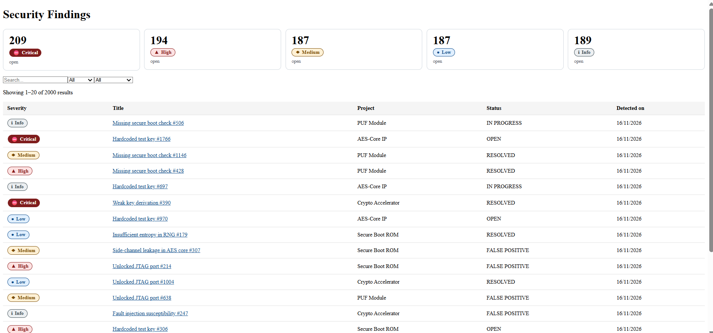
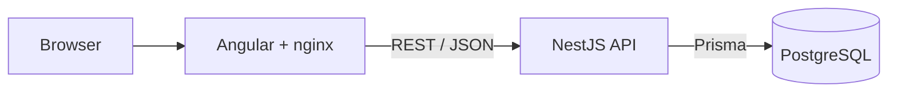

# Security Findings Dashboard

A full-stack dashboard for triaging security findings across hardware IP projects.
Built with **PostgreSQL, Prisma, NestJS, Angular and Docker**.



I built this to show how I approach a problem end to end: a normalized data model,
a validated and auditable API, and a UI that makes a large, complex dataset usable
(and accessible) for the person who has to decide what to fix first.

## Quick start

Requirements: Docker Desktop (and Node 22+ only for the seed step).

```bash
docker compose up --build
```

Then, in another terminal, load ~2,000 demo findings:

```bash
cd api
npm install
npx prisma db seed
```

| Service | URL |
|---|---|
| Dashboard | http://localhost:8080 |
| API + Swagger docs | http://localhost:3000/docs |

To start from scratch: `docker compose down -v`.

## Features

- **Summary first, detail second:** open findings per severity as clickable cards that filter the table.
- **Server-side filtering, search and pagination** over ~2,000 findings.
- **Filters and page live in the URL**, so views are shareable and Back/refresh work.
- **Detail panel** to change a finding's status. The API checks the role, saves the change and writes an audit log entry in one transaction.
- **Loading, empty and error states** that are announced to screen readers, with a retry action.
- **Accessible by design:** semantic table, keyboard navigation, visible focus, severity never conveyed by color alone.

## Architecture



```
findings-dashboard/
├── api/    NestJS + Prisma (modules: findings, prisma)
├── web/    Angular (core / features / shared)
└── docker-compose.yml
```

### Data model

`Project 1—N Finding 1—N AuditLog`

- `Finding`: title, description, severity, status, firstSeen
- Enums for `Severity` and `Status` enforce valid values in the database
- Composite index on `(projectId, status, severity)` matches the filters the UI uses, and an index on `firstSeen` supports the default ordering

### API

| Method | Endpoint | Purpose |
|---|---|---|
| GET | `/findings` | List with `severity`, `status`, `search`, `page`, `pageSize` |
| GET | `/findings/summary` | Open findings grouped by severity |
| PATCH | `/findings/:id/status` | Change status (requires the `analyst` role) |

Full interactive documentation is available at `/docs` (OpenAPI/Swagger).

## Design decisions and trade-offs

**Offset pagination (`skip`/`take`).** The UI needs to jump to arbitrary pages and the dataset is small, so offset is the simplest correct choice. For millions of rows I would switch to cursor pagination, because offset gets slower as the page number grows.

**URL as the source of truth for filters and page.** There is no duplicated state: changing a filter updates the URL, and the URL drives the data stream. A debounce avoids one request per keystroke, and `switchMap` cancels stale requests so an old, slow response can never overwrite a newer one.

**Status change and audit log in one transaction.** A finding can never change state without a record of who changed what and when. For a security tool, traceability is a requirement.

**Aggregation in the database.** The summary uses `groupBy`, so the browser never downloads thousands of rows just to count them.

**List state modeled as a union type** (`loading | error | ready`). Impossible states, such as loading and error at once, cannot exist, and the compiler forces every case to be handled. `catchError` lives inside the `switchMap` so one failed request does not kill the stream.

**Presentational components.** `FindingsPage` owns state and data fetching. The table, cards, badge and detail panel only receive inputs and emit events, which keeps them simple to reuse and test.

**No NgRx.** State is small and local to one page, so signals and RxJS in a page-level container are enough. I would add a store when state is shared across many features.

**Prisma CLI in `dependencies`.** The container runs `prisma migrate deploy` on startup so the stack works with one command. In a larger deployment I would run migrations as a separate job instead.

## Security

- **Input validation:** DTOs with `class-validator`; `whitelist: true` strips unknown fields (prevents mass assignment); `pageSize` is capped at 100.
- **SQL injection:** all queries go through Prisma's parameterized client.
- **Authorization in the backend:** a NestJS guard enforces roles. Hiding a button in the UI is never treated as a security control.
- **CORS** restricted to the web origin (configurable via `WEB_ORIGIN`).
- **Containers:** multi-stage builds, production dependencies only, API runs as a non-root user.
- **Errors** returned to the client are generic and do not expose internals.
- **Secrets:** `.env` is git-ignored. The credentials in `docker-compose.yml` are demo values only.

> **Known limitation:** authentication is a stub. The role is read from an `x-role` header, which anyone can forge, and the audit `actor` is a fixed string. This exists only to demonstrate the authorization flow. In production I would use SSO (OIDC) with validated JWTs and take the actor from the token.

## Accessibility

- Semantic `<table>` with caption and `scope` attributes; titles are real buttons, so they work with the keyboard
- Severity shown with **icon + text + color** (never color alone), with contrast chosen for WCAG AA
- Visible `:focus-visible` outlines; focus moves to the detail panel when it opens, and `Esc` closes it
- `role="status"` and `role="alert"` for loading and error states; `aria-live` for result counts; `aria-pressed` on the summary cards
- `prefers-reduced-motion` respected for the loading skeleton

## Known limitations

- Opening `?finding=<id>` directly in a new tab does not open the panel, because the selected finding is held in memory rather than fetched by id.
- The summary cards count open findings globally and do not react to the active filters.
- Authentication is a stub (see Security).

## What I would do next

- `GET /findings/:id` and deep-linkable detail panel
- Real authentication: OIDC/SSO, JWT validation, role claims
- Cursor pagination and virtual scrolling for very large datasets
- Scan ingestion: upload a scanner report, parse it asynchronously in a queue worker (BullMQ), and show import progress
- Summary that reflects the active filters, plus a trend over time
- Component tests and CI (build, test, scan on every push)
- Kubernetes manifests (Deployments, probes, ConfigMaps/Secrets) and migrations as a pre-deploy job

## Tech stack

| Layer | Technology |
|---|---|
| Database | PostgreSQL 16 |
| ORM | Prisma 6 |
| API | NestJS (Node.js), class-validator, Swagger |
| Frontend | Angular (standalone components, signals, RxJS, Reactive Forms) |
| Deployment | Docker, Docker Compose, nginx |

---


